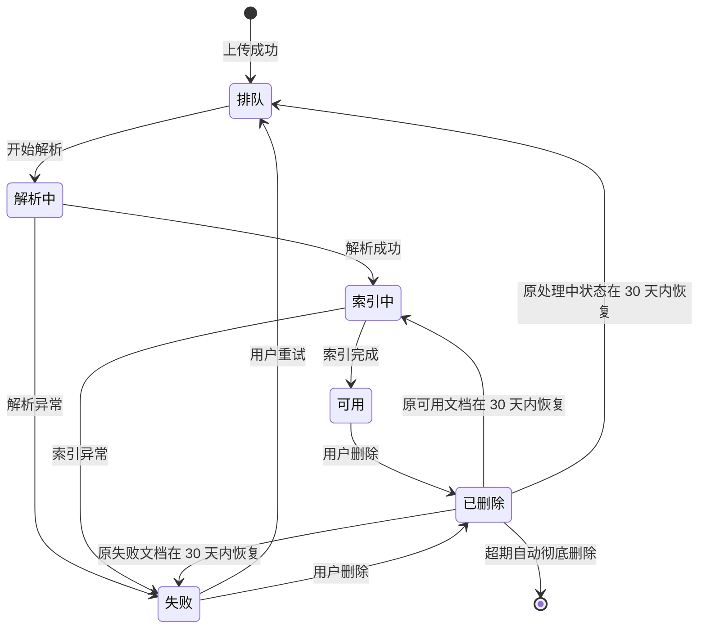

# 本地化知识库平台 · 产品需求文档（PRD）

> 2026-10-28 更新：移除知识库和文档回收站、恢复及保留期；删除直接清理相关内容且不可恢复。本文其余涉及回收站和恢复的历史描述以此更新为准。

> 版本：v0.5（P0 评审结论已合并，规格已发布） · 日期：2026-10-22 · 深度：新产品（完整功能需求）
> 依据：[竞品调研报告](./research/竞品调研报告.md) · 术语定义见 [GLOSSARY.md](../GLOSSARY.md)

> P0 评审过程、现有实现与缺口见 [P0需求核对与讨论](./P0需求核对与讨论.md)，实施规格见 [GitHub Issue #18](https://github.com/ObjectKjq/DFKnowledgeBase/issues/18)。本文描述目标行为，不表示相关能力已经实现或验收。

---

## 1. 背景与目标

**观察到的问题**（依据竞品调研）：面向个人（学生/工作者）的本地部署知识库存在两个行业空位——① 图片搜索（以文搜图 / 以图搜图 / 图内文字）几乎没有竞品完整覆盖；② 「网页端知识库 + 对外 MCP 服务端」的完整组合只有 Onyx 一家做到，且面向个人的实现缺失。现有开源 RAG 平台偏企业与开发者，部署复杂；自托管笔记工具又普遍没有 RAG 与多模态检索。

**受影响的用户与时刻**：学生与知识工作者在「资料散落、找不回、读不完」的时刻——写论文、复习、做方案时需要从自己积累的 PDF、笔记、截图、课件中快速找到依据，并信任答案的出处。

**产品决策**：做一个可本地化部署的知识库平台，统一提供关键字、向量、图片三种检索与带引用的 RAG 检索，并把同一知识库通过 MCP 服务端以用户级凭证供给 Codex、Trae 等 AI 智能体使用。交互形态采用聊天为主的单消息流界面（见 §6）。

**预期可观察结果**：

- P0 用户上传文档后，能用混合、模糊或引导检索找到内容，命中处可定位到原文位置；图片搜索后续交付；
- 用户提问后得到的答案逐条附带引用，点击引用可在预览抽屉中打开原文对应块/页；依据不足时系统明确拒答而不是编造；
- 用户创建 MCP 凭证后，任意支持 MCP 的 AI 智能体能检索到该用户有权访问的同一批知识，且凭证可随时撤销。

## 2. 产品契约

| 要素 | 定义 |
|---|---|
| 主要用户 | 学生与知识工作者（实例管理员创建用户；每人拥有个人知识库，可自建个人/共享知识库，共享库可协作） |
| 核心工作 | 把分散资料（PDF、Office 文档、图片、文本等）存入本地知识库，用多种检索模式找到它们，用带引用的答案消费它们，并让 AI 智能体经 MCP 在授权范围内使用同一批知识 |
| 触发 | 用户上传/整理资料，或在聊天窗口发起检索、问答；或在 AI 智能体中通过 MCP 发起检索 |
| 完成条件 | 用户检索到目标内容或获得带可跳转引用的答案；智能体经 MCP 完成一次授权范围内的检索/问答 |
| 共享业务对象 | 知识库（个人/共享）、文档、分块（chunk）、图片资源、引用、会话、MCP 凭证 |
| 信任基础 | 全部数据存放在用户自己的部署环境内；每用户独立身份与凭证；检索、问答、MCP 三条链路都只返回该用户有权访问的内容（详见 §8.1 权限矩阵） |

## 3. 用户故事

故事格式：作为〈角色〉，我希望〈目标〉，以便〈价值〉。每条映射到功能需求编号（见 §7）。

### 3.1 P0 用户故事

| ID | 角色 | 用户故事 | 覆盖需求 |
|---|---|---|---|
| US-01 | 学生 | 作为学生，我希望把课件、论文、笔记和扫描 PDF 上传到自己的知识库，以便学习文档集中在一处 | FR-3 |
| US-02 | 学生 | 作为学生，我希望用「讲梯度下降那页」这样的模糊描述也能找到内容，以便凭记忆碎片快速定位资料 | FR-4 |
| US-05 | 学生 | 作为学生，我希望提问后得到带引用的答案并能点开原文，以便复习时确认依据、不被误导 | FR-5 |
| US-06 | 学生 | 作为学生，我希望在资料不足时得到明确的「未找到依据」而不是编造的答案，以便知道该去补什么资料 | FR-5 |
| US-07 | 工作者 | 作为工作者，我希望创建共享知识库并邀请同事分角色协作，以便团队资料共建共用 | FR-2 |
| US-08 | 工作者 | 作为工作者，我希望把知识库接给 Codex、Trae 等 AI 智能体使用，以便在写代码、写文档的现场直接引用我的知识 | FR-6 |
| US-09 | 工作者 | 作为工作者，我希望 MCP 凭证默认只读、可设过期、可随时撤销，以便在便利与安全之间可控 | FR-6 |
| US-10 | 工作者 | 作为工作者，我希望被移出共享库后智能体立刻看不到该库内容，以便权限变更即刻生效 | FR-6 |
| US-11 | 实例管理员 | 作为实例管理员，我希望配置一次模型接入并测试连通，以便全体用户开箱可用 | FR-7 |
| US-12 | 实例管理员 | 作为实例管理员，我希望在模型不可用时看到明确提示而不是静默降级，以便及时处理故障 | FR-7 |
| US-13 | 用户 | 作为用户，我希望上传失败的文档能看到原因并一键重试，以便不用整批重传 | FR-3 |
| US-14 | 用户 | 作为用户，我希望删除的文档 30 天内可恢复，以便误删可挽回 | FR-3 |
| US-25 | 学生 | 作为学生，我希望不确定要找什么时用引导检索，让系统反问几句再帮我搜，以便模糊的需求也能找到结果 | FR-4 |
| US-26 | 用户 | 作为用户，我希望点开结果卡片或引用时在右侧抽屉看到原文并自动定位，以便边聊边核对不丢上下文 | FR-4 |
| US-27 | 工作者 | 作为工作者，我希望在输入框直接切换检索模式和命名对话模型，以便按任务选择合适的执行方式 | FR-4、FR-7 |
| US-28 | 用户 | 作为用户，我希望把检索范围限定在某个知识库或全局，以便控制检索的边界 | FR-4 |

### 3.2 P1 用户故事

| ID | 角色 | 用户故事 | 覆盖需求 |
|---|---|---|---|
| US-15 | 学生 | 作为学生，我希望把网页文章一键存进知识库，以便读到的好资料不再丢失 | FR-9 |
| US-16 | 工作者 | 作为工作者，我希望在完全离线、不依赖云端模型的环境里使用全部功能，以便满足数据不出本机的场景 | FR-10 |
| US-17 | 学生 | 作为学生，我希望系统自动给文档打标签、提示重复内容，以便知识库不越用越乱 | FR-11 |
| US-18 | 工作者 | 作为工作者，我希望复杂问题能被自动拆解成多次检索并汇总，以便跨文档的多跳问题也能答准 | FR-12 |
| US-19 | 用户 | 作为用户，我希望看到命中分块的原文预览并对答案点赞点踩，以便判断结果质量、帮助改进 | FR-13 |
| US-20 | 学生 | 作为学生，我希望用描述或图片搜到 PPT 图表、扫描件页面里的内容，以便图片搜索覆盖文档内嵌图 | FR-8 |

### 3.3 P2 用户故事

| ID | 角色 | 用户故事 | 覆盖需求 |
|---|---|---|---|
| US-21 | 学生 | 作为学生，我希望提问「我这学期所有笔记里反复出现的概念」得到整库级综述，以便宏观把握知识全貌 | FR-14 |
| US-22 | 用户 | 作为用户，我希望表格续页、代词指代这类跨分块问题也能被答对，以便检索质量不受分块边界影响 | FR-15 |
| US-23 | 用户 | 作为用户，我希望复杂版面的扫描件/图表页不经过 OCR 也能被检索到，以便视觉内容零损耗入库 | FR-16 |
| US-24 | 学生 | 作为学生，我希望把一个主题的资料生成播客式音频概览或研究报告，以便换种方式消化长材料 | FR-17 |

### 3.4 移除或后置的故事

- US-03（独立精确检索模式）：2026-10-22 评审移除；关键词匹配仍参与混合检索，不提供独立模式。
- US-04（OCR 图内文字检索、以文搜图、以图搜图）：移出本次 P0，后续具体优先级另定。
- 独立图片文档入库、图片 RAG 证据、联网搜索及相关技能入口随对应能力后置；扫描 PDF 的 OCR 文字入库保留在 P0。

## 4. 角色、对象与状态

### 4.1 角色

| 角色 | 说明 |
|---|---|
| 实例管理员 | 部署者角色。负责用户创建、模型接入、MCP 总开关、限流与入库并发设置。不天然拥有他人知识库的内容访问权 |
| 用户 | 由实例管理员创建；拥有个人知识库的权限，可创建知识库（个人/共享），创建共享库即成为其所有者 |
| 共享库所有者 | 共享知识库的创建者，管理成员、角色与库本身 |
| 共享库编辑者 | 可检索/问答并管理（上传、删除）库内文档 |
| 共享库查看者 | 仅可检索/问答/查看库内内容 |

### 4.2 核心对象

| 对象 | 关键属性 | 说明 |
|---|---|---|
| 知识库 | 名称、类型（个人/共享）、所有者、成员与角色、文档集合、删除状态 | 创建用户时自动创建默认个人知识库「我的知识库」（不可删除）；其他个人/共享知识库支持软删除及 30 天内恢复；一期不提供所有权转让 |
| 文档 | 标题、来源、格式、所属知识库、解析状态、上传时间、大小 | 一个文档只属于一个知识库；删除为软删除，30 天内可恢复；独立图片文档入库后置 |
| 分块（chunk） | 所属文档、块序号、文本内容、原文定位（页码/段落） | 检索与引用的最小定位单位 |
| 图片资源 | 所属文档、缩略图、OCR 文本、图片向量 | 独立图片文件或文档内嵌图片，均进入图片检索范围 |
| 引用 | 指向某个分块或图片资源的定位符 | RAG 检索答案的溯源单位，点击可在预览抽屉打开原文 |
| 会话 | 所属用户、检索范围、模式记录、所选上下文、消息流（含结果卡片与引用） | 按用户隔离，跨设备保留；一次检索/问答完整保存在消息流中 |
| MCP 凭证 | 所属用户、令牌、工具开关、过期时间、创建/最后使用时间 | 以凭证持有者的身份与可见范围执行，详见 FR-6 |
| 标签 | 名称、所属知识库、关联文档集合 | P1 起由系统自动打标或用户手动维护（FR-11） |

### 4.3 文档生命周期状态

只有「可用」的文档参与检索与问答；各状态的允许操作详见 §8.2。

## 5. 范围（最小完整旅程）

- **入口条件**：实例管理员创建用户，用户登录成功后进入聊天主界面，默认全局检索范围。
- **P0 动作**：上传文档并等待整份解析、索引完成 → 在聊天窗口用混合/模糊/引导检索找到内容 → 用 RAG 检索获得带引用的答案 → 创建 MCP 凭证并在 AI 智能体中完成一次检索 →（可选）创建共享知识库并邀请成员。
- **完成证据**：检索结果可定位到原文位置；答案引用可在预览抽屉打开；MCP 客户端成功列出工具并返回授权范围内的结果。
- **恢复路径**：文档解析失败 → 展示失败原因并支持重试（FR-3）；答案依据不足 → 明确拒答并给出改写建议（FR-5）；凭证泄露 → 立即撤销（FR-6）。
- **P1（随一期之后交付）**：图片搜索二期（FR-8）、剪藏与网页导入（FR-9）、本地模型与离线模式（FR-10）、知识治理（FR-11）、Agentic 检索增强/深度检索技能（FR-12）、检索结果可视化与答案反馈（FR-13）。
- **P2（远期）**：知识图谱整库综述（FR-14）、上下文化分块（FR-15）、视觉第二索引（FR-16）、内容再消费（FR-17）。
- **明确排除**（若遗漏会产生分歧故列明）：移动端应用、企业级 SSO/LDAP、多实例联邦检索。以上三项不在本 PRD 任何优先级内。

> **2026-10-22 范围调整**：图片搜索基础能力、独立图片文档入库和联网搜索均移出本次 P0，具体交付优先级另定。FR-8 的图片增强能力仍为 P1，依赖基础图片能力先行交付。独立精确检索模式移除；扫描 PDF 的 OCR 文字参与普通检索，不属于图片搜索。

## 6. 界面与交互

界面采用**聊天为主的单消息流**形态（参照 Codex 式布局），管理能力收敛到独立管理页。本章是界面交互的唯一权威定义，FR 内的「布局」仅补充模块细节。

### 6.1 页面结构

- **左侧栏**：顶部「新检索」按钮；「知识库」列表（个人库置顶、共享库分组，点击即把检索范围切换到该库）；「最近会话」列表（点击恢复会话消息流）；底部「设置」入口（文档管理、MCP 凭证、实例设置、账号）。
- **主区**：会话消息流（用户消息、系统澄清、结果卡片、答案与引用按时间流排布）+ 底部常驻输入框。
- **右侧预览抽屉**：点击结果卡片或引用时滑出，显示原文并自动滚动定位到命中处；提供「在新页打开」兜底入口；抽屉打开/关闭不中断会话上下文。
- **首屏空态**：居中问候语（「今天想找什么？」）+ 3 个快捷入口（上传文档 / 向知识提问 / 连接 AI 智能体），输入框常驻。

### 6.2 输入框

- **内顶部 chips**：范围 chip（默认「全局检索」，点击弹出知识库多选）；选中分块时展示所选上下文的数量及清空入口。
- **底部左侧**：「＋」菜单提供上传文档；拖拽支持的文档进入上传流程，独立图片格式提示当前不支持，不进入图片查询。
- **底部右侧**：检索模式选择器 → 命名对话模型选择器 → 发送按钮。不提供独立档位开关。
- **技能（skill）**：联网搜索、图片搜索及其入口后置；深度检索随 FR-12 提供。P0 不展示尚未交付的技能开关。
- **模型选择器**用于引导检索和 RAG 检索；向量模型固定内置，重排模型在实例设置配置，不在聊天界面切换。

### 6.3 检索模式（唯一权威定义）

| 模式 | 行为 | 结果形态 |
|---|---|---|
| **混合检索**（默认） | 关键字与语义两路匹配融合排序后直接返回结果 | 结果卡片列表 |
| **模糊检索** | 仅按语义含义匹配（模糊描述、同义表述） | 结果卡片列表 |
| **引导检索** | 先以系统消息反问澄清（附推荐选项按钮，点选或直接输入均可），最多 2 轮，随后按已知信息执行混合检索；用户可随时点「跳过引导直接搜」 | 澄清消息 → 结果卡片列表 |
| **RAG 检索** | 执行检索并基于结果生成带引用答案；同一会话支持追问多轮（上下文继承） | 答案文本 → 引用卡片 |

- 默认模式为**混合检索**；模式选择在**会话内记忆**（切换后本会话沿用，新会话重置为默认）；每条消息发送前可随时切换。
- 消息流规则：每次检索的「用户消息 →（引导澄清）→ 结果/答案」及当次范围、过滤条件、模式完整保留在会话流中；卡片展示字段见下文。
- 点击结果卡片或引用 → 右侧预览抽屉打开并定位。

- P0 仅提供上述四种模式，不提供独立精确检索。
- 引导检索使用所选对话模型；模型未配置或调用失败时显示原因，提供“直接混合检索”，不得静默切换。
- 混合检索融合关键词与语义匹配，模糊检索只使用语义匹配。
- 结果卡片展示标题、命中片段及高亮、所属知识库和文档位置、实际命中类型与相关性；扫描 PDF 可标识 OCR 文本来源。
- PDF 展示原始页面并跳到命中页；TXT、Markdown 展示原文并定位；Office 展示解析内容，保留适用的页码、幻灯片编号或工作表信息，不要求完整还原排版。所有格式提供新页打开或下载原文件入口，均重新校验权限。

### 6.4 管理页

文档管理（FR-3）、MCP 凭证（FR-6）、实例设置（FR-7）、共享成员管理（FR-2）均以管理页承载，从左侧栏「设置」进入。破坏性操作（删除知识库、撤销凭证、移除成员）保留二次确认。

## 7. 功能需求

功能需求为本文档主体。共享规则（权限矩阵、状态机、凭证规则、异常边界）统一放在 §8，正文只引用不重复。

### 7.1 P0 需求

#### FR-1 账号与会话

**目的**：为多用户与用户级凭证提供身份基础。登录是全部功能的前置条件。

| 项 | 规则 |
|---|---|
| 触发 | 未登录用户访问任意受保护页面 → 引导至登录；没有用户身份时联系实例管理员创建 |
| 处理规则 | 用户由实例管理员创建，用户名唯一；创建成功自动创建默认个人知识库（FR-2）；不提供自助注册；会话过期后需重新登录 |
| 结果与状态 | 登录后进入聊天主界面（§6.1）；顶部始终可见当前用户 |
| 异常 | 用户名重复、密码不符合规则 → 明确字段级提示，不破坏已填内容 |

#### FR-2 知识库与共享

**目的**：让用户拥有私有资料空间，并能以最小成本把知识共享给同学/同事。

**布局**：知识库列表位于左侧栏（§6.1）；文档与成员管理位于管理页（§6.4）；检索与问答在主聊天区完成。

| 项 | 规则 |
|---|---|
| 触发 | 创建用户完成（自动建默认个人知识库）；或用户在管理页新建知识库（创建时指定类型：个人/共享） |
| 处理规则 | 默认个人知识库：创建用户时自动创建，名称默认「我的知识库」，不可删除；个人知识库：仅所有者可见、不可添加成员，除默认知识库外可自建多个、可删除；共享知识库：任意用户可创建，创建者为所有者，所有者通过用户名邀请成员并分配成员角色（编辑者/查看者），可更改成员角色或移除成员（权限见 §8.1） |
| 结果与状态 | 被邀请成员的左侧栏即时出现该共享库；角色变更即时生效（包括已建立的 MCP 会话检索范围） |
| 字段 | 库名称（必填，≤50 字符）；库类型（个人/共享，创建时指定）；库说明（可选，≤200 字符） |
| 异常 | 邀请不存在的用户名 → 提示「用户不存在」；所有者不可退出或移除自己，一期不提供所有权转让；删除知识库需二次确认，并说明成员将立即无法访问 |
| 删除与恢复 | 默认个人知识库不可删除；其他个人/共享知识库软删除后保留 30 天，仅原所有者可恢复，恢复时保留原成员关系。支持再次确认后手动彻底删除；超期自动清理，详见 §8.5 |

#### FR-3 文档采集与入库

**目的**：把本地资料可靠地变成「可检索、可引用」的知识，是检索与问答的前提。

**布局**：文档列表位于「文档管理」页（§6.4，字段：标题、格式、状态、时间、大小、操作）；上传入口同时提供在输入框「＋」菜单与管理页，支持多选与拖拽。

| 项 | 规则 |
|---|---|
| 触发 | 有编辑权限的用户上传文件（拖拽或选择） |
| 处理规则 | P0 支持 PDF、Word、PPT、Excel、TXT、Markdown；独立图片文档后置。单文件上限 50 MB，单知识库容量暂不设上限；同名文件允许重复上传，以上传时间区分。入库流程：排队 → 解析中 → 索引中 → 可用。PDF 有文本的页直接提取，无文本的页执行 OCR；所有页面处理成功后才统一建立关键词与向量索引，禁止部分页面提前参与检索。任一页处理失败则整份文档失败，并显示页码与原因。表格至少保留表头与行列对应关系，不要求还原视觉样式 |
| 结果与状态 | 状态流转见 §8.2；「可用」后文档出现在检索与问答范围；文档管理页实时显示进度状态 |
| 权限 | 查看者不可上传/删除；编辑者与所有者可上传、删除、重试 |
| 异常 | 格式不支持 → 上传前拦截并列明支持格式；解析失败 → 状态「失败」并显示原因（如「扫描质量过低」「文件损坏」），支持「重试」；重试再次失败保留首次原因；删除为软删除，30 天内可恢复；支持手动彻底删除及超期自动清理，状态与恢复流程见 §8.2 |

#### FR-4 检索

**目的**：用混合、模糊、引导检索找回用户自己的内容，并定位到原文位置；RAG 模式的生成行为见 FR-5。

**布局**：经聊天输入框发起（§6.2），结果以卡片流呈现在消息流中（§6.3）；范围在输入框顶部 chip 切换，类型及时间过滤可叠加。

| 项 | 规则 |
|---|---|
| 触发 | 登录用户在输入框输入查询并发送 |
| 处理规则 | 四种模式（混合/模糊/引导/RAG）见 §6.3；默认全局范围（全部有权知识库），可收窄至多选知识库。P0 支持文档类型和上传时间过滤、分页，默认每页 20 条；标签过滤随 P1 标签能力交付。不提供独立精确检索；图片搜索后置 |
| 结果字段 | 标题、命中片段与关键词高亮、来源定位（所属知识库 › 文档 › 页/幻灯片/工作表/分块）、实际命中类型、相关性；扫描 PDF 标记 OCR 文本来源 |
| 结果与状态 | 点击结果卡片/引用在右侧预览抽屉打开并定位（§6.3）；仅返回当前用户有权访问且可用的文档；可勾选分块作为 RAG 所选上下文（FR-5） |
| 权限 | 查看者、编辑者、所有者均可检索自己有权访问的库；无权限内容不出现在结果中，也不通过计数等方式泄露存在性 |
| 异常 | 空结果 → 展示「未找到」并给出建议（切换模糊检索、放宽过滤、检查范围）；查询为空 → 提示输入；索引构建中 → 检索仍可用，但提示当前有权范围内「部分新文档索引中」；空知识库提示上传 |

#### FR-5 RAG 检索（带引用答案）

**目的**：把检索到的内容转化为可信任的答案——每条结论都能回到原文。本需求定义 RAG 检索模式（§6.3）的生成行为。

**布局**：经聊天输入框以 RAG 检索模式发起；答案文本呈现在消息流中，下方排列引用卡片；范围选择复用输入框范围 chip。

| 项 | 规则 |
|---|---|
| 触发 | 用户以 RAG 检索模式发送问题；可先在检索结果卡片中勾选内容加入上下文 |
| 处理规则 | 答案只基于「用户当前有权访问 ∧ 所选范围 ∧ 解析状态为可用」的内容生成。勾选分块后仅使用所选上下文，不自动补搜；未勾选时自动检索。追问沿用所选上下文，可调整或清空；每次发送重新校验权限和状态。每个论断附块级/页级引用，优先展示支撑性最强的来源；依据不足时明确拒答并建议扩大范围、换问法，不得编造；图片证据随图片能力后置 |
| 结果与状态 | 答案渲染后，点击引用在右侧预览抽屉打开原文并定位（FR-4 的定位规则复用）；问答保存在会话消息流中，按用户隔离 |
| 权限 | 被移出共享库后，其后续问答立即不再包含该库内容；历史会话中已生成的答案保留，但引用跳转对无权限内容显示「无权访问」 |
| 异常 | 生成失败/超时 → 提示重试并保留问题；服务未配置模型 → 管理员可进入实例设置，普通用户提示联系管理员；空范围提问 → 提示选择范围 |
| 流式展示 | 生成中标记“正在生成”；完成后校验引用，依据不足或引用无效时完整替换为明确拒答并清除暂定引用。仅保留通过最终校验的答案或拒答结果；验收覆盖无依据、错误引用、权限撤回及跨文档结论 |

#### FR-6 MCP 服务端

**目的**：让 Codex、Trae、Claude 等 AI 智能体通过标准 MCP 协议使用同一知识库，且访问范围严格等于凭证持有者的权限。这是本产品的差异化模块。

**布局**：「MCP 接入」管理页（§6.4）= 凭证列表 + 新建凭证表单 + 接入指引（含各客户端配置示例）。

| 项 | 规则 |
|---|---|
| 触发 | 登录用户在「MCP 接入」页面新建凭证；或在 AI 智能体侧使用已有凭证发起调用 |
| 处理规则 | 凭证绑定创建者身份，作用域始终等于该用户当前有权访问的知识库。P0 工具：`search`（混合/模糊）、`ask`（RAG）、`list_knowledge_bases`；不提供写入工具及 `search_images`。每份凭证独立选择开放工具，默认只读、90 天过期，可设 1～365 天，不提供永久凭证；令牌仅创建时完整展示一次。撤销、成员权限变化立即作用于后续调用，包括已建立连接中的新调用 |
| 结果与状态 | 创建后给出接入配置（含示例命令/配置片段）；凭证列表展示名称、工具开关、过期时间、最后使用时间；每次调用记入调用记录（时间、工具、目标库、结果条数） |
| 权限 | 用户只能查看/管理自己的凭证；实例管理员可停用全部 MCP 接入（实例级开关，见 FR-7）但不能查看他人令牌明文 |
| 异常 | 令牌无效/过期/已撤销 → 返回明确错误且不泄露内容；超出工具开关范围 → 拒绝并记录；默认每份凭证每分钟最多 60 次工具调用，管理员可调整；超限提示重试。失败与拒绝调用记录原因，不记录文档正文或令牌明文 |

#### FR-7 实例设置（模型接入）

**目的**：RAG 检索与语义检索依赖模型服务；实例级只需配置一次，全体用户共用。

| 项 | 规则 |
|---|---|
| 触发 | 实例管理员进入实例设置；引导检索/RAG 未配置模型时，管理员可进入此页，普通用户提示联系管理员 |
| 处理规则 | 管理员可维护多个命名对话模型配置（名称、服务地址、密钥、模型名），按 OpenAI 兼容协议接入，是聊天模型选择器的来源；不另设档位。文本向量模型固定内置 bge-small-zh-v15（512 维），不提供切换；重排模型可选，未配置时使用现有融合排序。真实配置保存、连接测试、故障提示纳入 P0。管理员同时管理 MCP 总开关、限流及入库并发；普通用户无配置权限 |
| 结果与状态 | 配置保存后全实例生效；配置项含状态（可用/不可用）与最近测试时间 |
| 异常 | 测试连接失败 → 显示地址不可达/鉴权失败/超时等原因；问答模型不可用 → 明确提示，不静默切换其他模型；内置向量不可用时明确报告检索故障；引导检索的直接检索入口见 §6.3 |

### 7.2 P1 需求

#### FR-8 图片搜索二期（caption 与页面级视觉索引）

**目的**：把图片搜索从「OCR 文字 + 全局向量」扩展到描述语义与文档内嵌视觉内容，扩展后续基础图片搜索的覆盖范围。

| 项 | 规则 |
|---|---|
| 触发 | 文档入库（自动建立 caption 索引）；用户使用后续图片搜索能力 |
| 处理规则 | 入库时为每张图片资源生成自然语言描述（caption）并建立第三路索引，与 OCR 文本、图片向量共同参与图片搜索；文档内嵌图（PPT 图表、论文插图、扫描页）按页建立视觉索引，支持以文搜图命中页面并返回页面位置；检索结果按三路综合相关性排序 |
| 结果与状态 | 图片搜索结果卡片新增「描述命中」标签；命中可在预览抽屉中打开图片/页面位置 |
| 权限 | 同 FR-4 权限规则，作用于图片/页面粒度 |
| 异常 | caption 生成失败 → 该图片回退为仅 OCR+向量两路，标记「描述缺失」；视觉索引构建失败 → 文档其余检索能力不受影响 |

#### FR-9 剪藏与网页导入

**目的**：低摩擦采集入口，防止「读到的好资料」流失在浏览器里。

| 项 | 规则 |
|---|---|
| 触发 | 用户在文档管理页点击「导入网页」输入 URL；或使用浏览器扩展的一键剪藏 `[Assumption, TBD：浏览器扩展形态是否随 P1 交付]` |
| 处理规则 | 抓取网页正文（去导航/广告），保留标题、原文 URL、抓取时间作为文档元数据；正文进入标准入库流程（FR-3）；剪藏时可选择目标知识库；支持整页抓取与选中片段抓取两种模式 |
| 结果与状态 | 生成的文档「来源」字段标记为网页并保留可点击的原文链接；与普通文档同样参与检索/问答 |
| 权限 | 同 FR-3 编辑权限；剪藏的目标库必须是用户可写入的库 |
| 异常 | 抓取失败（反爬/超时/需登录）→ 提示失败原因并允许粘贴正文作为纯文本入库；重复 URL 剪藏 → 提示已有同源文档，可选择覆盖或另存 |

#### FR-10 本地模型与离线模式

**目的**：满足数据不出本机的使用场景，同时降低个人部署成本。

| 项 | 规则 |
|---|---|
| 触发 | 实例管理员在 FR-7 中选择本地模型服务；或断网状态下使用系统 |
| 处理规则 | 支持全部三类模型（对话/向量/重排）指向本机模型服务实现完全离线运行；离线模式下检索、问答、MCP 全部可用，仅外部网页导入（FR-9）与后续联网搜索技能不可用；提供「低配模式」，具体裁剪项另行评审，不重新引入已移除的独立精确检索模式 |
| 结果与状态 | 设置页显示当前运行模式（在线/离线/低配）；功能入口与技能 chips 按模式自动置灰并说明原因 |
| 异常 | 本地模型服务未就绪 → 明确提示安装/启动指引；切换模型服务后提示需重建索引并给出重建入口（见 FR-11 重建规则） |

#### FR-11 知识治理

**目的**：防止知识库「越用越乱」，保持检索质量。

| 项 | 规则 |
|---|---|
| 触发 | 用户打开知识库治理面板；或系统在入库完成后自动执行打标 |
| 处理规则 | **自动打标**：入库完成后按内容自动生成标签建议，用户一键采纳/忽略；**重复检测**：内容高度相似的文档（如同一篇讲义的两个版本）在列表中标记「疑似重复」，由用户选择保留/删除；**重建索引**：模型或解析配置变更后可对单库重建索引，重建期间原文档保持可检索（旧索引服务至新索引就绪） |
| 结果与状态 | 标签可用于 FR-4 过滤；重复标记不影响检索；重建完成后更新索引版本号与时间 |
| 权限 | 自动打标结果所有成员可见；采纳/删除/重建仅编辑者及以上可操作 |
| 异常 | 打标模型不可用 → 跳过自动打标不阻塞入库；重建中断 → 保留旧索引并提示重试 |

#### FR-12 Agentic 检索增强（深度检索技能）

**目的**：复杂问题不再受限于「一次检索一次生成」，提升多跳与跨文档问题的回答质量。

| 项 | 规则 |
|---|---|
| 触发 | 用户开启输入框「深度检索」技能；或以 RAG 检索模式提问且被判定为复杂问题（多实体、对比、跨文档归纳） |
| 处理规则 | 系统将问题拆解为多个子查询，逐次检索并汇总；支持查询改写（补全指代、扩展同义表述）与检索路由（文本问题走混合检索、图片问题走图片搜索）；拆解过程与各步引用在答案中可展开查看；单次问答的子查询步数上限 `[TBD]`，防止无限循环 |
| 结果与状态 | 答案引用覆盖全部子查询来源；展示「已执行 N 步检索」的过程摘要 |
| 权限 | 同 FR-5；子查询的检索范围仍限定在用户所选范围 |
| 异常 | 中间步骤失败 → 已获得的部分结果仍作答并标注「部分来源检索失败」；超步数上限 → 停止并以现有结果作答 |

#### FR-13 检索结果可视化与答案反馈

**目的**：让用户能判断结果质量并沉淀反馈，形成质量闭环。

| 项 | 规则 |
|---|---|
| 触发 | 用户在结果卡片/答案上执行操作 |
| 处理规则 | 命中分块支持「查看原文上下文」（在预览抽屉中展开前后相邻分块）；答案提供有用/无用反馈按钮，可选填原因；反馈与对应会话关联保存 |
| 结果与状态 | 反馈记录仅本人可见；统计视图（本人的反馈历史）在设置中可查 `[Assumption, TBD：统计视图是否随 P1 交付]` |
| 权限 | 仅本人可对自己会话的反馈操作与查看 |
| 异常 | 反馈提交失败 → 本地暂存并允许重试，不影响答案阅读 |

### 7.3 P2 需求

#### FR-14 知识图谱整库综述（GraphRAG）

**目的**：回答「跨文档多跳」与「整库归纳」类问题，这是普通向量检索答不了的。

| 项 | 规则 |
|---|---|
| 触发 | 用户对单库开启「知识图谱索引」；或提问被识别为整库综述类问题 |
| 处理规则 | 入库/按需为知识库抽取实体与关系形成图谱索引（可选，按库开启，成本较高）；检索时图谱索引与普通索引并行，支持两类问法：实体邻域问答（「A 和 B 的关系」）、整库综述（「反复出现的概念」）；图谱答案同样附引用（指向支撑实体的分块） |
| 结果与状态 | 开启图谱的库在结果卡片中标注「图谱增强」；综述类答案附来源分布概览 |
| 权限 | 开启/重建图谱仅所有者与编辑者；图谱查询结果遵守 §8.1 权限过滤 |
| 异常 | 图谱抽取失败 → 回退普通检索作答并标注「图谱不可用」；建图中 → 提示进度且普通检索不受影响 |

#### FR-15 上下文化分块（Contextual Retrieval）

**目的**：修复分块断章取义（表格续页、代词指代）导致的检索失败，提升召回质量。

| 项 | 规则 |
|---|---|
| 触发 | 文档入库（可选项，按库配置）；或实例管理员在重建索引时启用 |
| 处理规则 | 分块入库前为每块生成一段「所属文档上下文说明」，与原文一起参与索引；该说明只用于检索匹配，不进入答案正文与引用展示；属入库期一次性成本，不增加查询时延 |
| 结果与状态 | 启用后该库索引标记「上下文化」；检索命中率提升，用户无额外操作 |
| 权限 | 配置开关仅所有者与编辑者；实例级默认值由实例管理员设定 |
| 异常 | 上下文生成失败 → 该块回退普通分块索引，不影响入库完成 |

#### FR-16 视觉第二索引（页面级视觉检索）

**目的**：让复杂版面的扫描件、图表密集页在 OCR 易碎的情况下也能被检索到。

| 项 | 规则 |
|---|---|
| 触发 | 实例管理员为指定库开启「视觉索引」；或文档被识别为扫描件/图表密集型 |
| 处理规则 | 对文档逐页生成页面级视觉向量，检索时与文本索引两路并行融合；命中以「页」为粒度返回（含页面缩略图），作为文本分块命中之外的补充证据；纯文本精确匹配（编号、人名）仍以文本索引为准 |
| 结果与状态 | 结果卡片新增「页面命中」类型；RAG 检索可引用页面作为证据 |
| 权限 | 同 FR-4；索引开启/关闭仅所有者与编辑者 |
| 异常 | 视觉索引未开启或构建失败 → 自动回退文本检索，不阻塞；存储不足 `[TBD]` → 提示并暂停视觉索引 |

#### FR-17 内容再消费（音频概览与研究报告）

**目的**：让用户用「听」和「读报告」两种方式消化长材料，延伸知识库价值。

| 项 | 规则 |
|---|---|
| 触发 | 用户在指定库/选定文档集合上点击「生成音频概览」或「生成研究报告」 |
| 处理规则 | **音频概览**：把所选内容生成双人对谈式音频，支持倍速与章节跳转，生成物作为库内衍生资源保存（引用同一套来源引用规则）；**研究报告**：围绕指定主题跨文档汇总生成结构化报告，逐段附引用；生成物可再入库成为新文档 |
| 结果与状态 | 衍生资源标注「AI 生成」与来源清单；与普通文档一样可检索、可删除 |
| 权限 | 生成操作仅编辑者及以上；生成物可见性跟随所在库的成员权限 |
| 异常 | 生成失败/超时 → 提示重试并保留任务参数；所选内容过少 → 提示扩大选择范围 |

## 8. 共享规则与例外

### 8.1 权限矩阵（唯一权威定义）

| 操作 | 个人库所有者 | 共享库所有者 | 共享库编辑者 | 共享库查看者 | 非成员 |
|---|---|---|---|---|---|
| 查看 / 检索 / 问答 | ✔ | ✔ | ✔ | ✔ | ✘ |
| 上传文档 | ✔ | ✔ | ✔ | ✘ | ✘ |
| 删除 / 恢复文档 | ✔ | ✔ | ✔ | ✘ | ✘ |
| 彻底删除文档 | ✔ | ✔ | ✔ | ✘ | ✘ |
| 重试解析 | ✔ | ✔ | ✔ | ✘ | ✘ |
| 邀请 / 移除成员、改角色 | —（无共享概念） | ✔ | ✘ | ✘ | ✘ |
| 删除 / 恢复 / 彻底删除知识库 | ✔（默认个人知识库不可删除） | ✔ | ✘ | ✘ | ✘ |
| 创建/撤销自己的 MCP 凭证 | ✔（仅限本人凭证；作用域 = 本人当下有权访问的全部库，四类角色均适用） | ✔ | ✔ | ✔ | ✘ |

跨库检索/问答的结果过滤以本矩阵为准；任何链路（网页检索、RAG 检索、MCP 调用）不得返回用户无权访问的内容，也不得泄露其存在性。P1/P2 新增操作（打标、重建索引、图谱开启、生成衍生资源）的权限在对应 FR 内定义，与本矩阵冲突时以本矩阵为底线。

### 8.2 文档生命周期（唯一权威定义）

| 状态 | 进入条件 | 允许操作 | 离开条件 |
|---|---|---|---|
| 排队 | 上传成功 | 删除 | 解析开始 → 解析中 |
| 解析中 | 轮到该文档处理 | 删除 | 解析成功 → 索引中；解析失败 → 失败 |
| 索引中 | 解析完成 | 删除 | 索引完成 → 可用；索引失败 → 失败 |
| 可用 | 索引完成 | 检索/问答/删除 | 删除 → 已删除（软删除 30 天） |
| 失败 | 解析或索引异常 | 重试（回到排队）/ 删除 | 重试成功 → 可用；删除 → 已删除 |
| 已删除 | 用户删除 | 30 天内恢复 / 彻底删除 | 超过保留期 → 自动彻底删除 |

原可用文档恢复后进入索引中，重建成功再可用；原处理中状态恢复后重新排队处理；原失败文档恢复为失败，仍可重试。所有页面必须处理成功后才统一索引并进入可用状态；索引过程中即使已有部分索引，也不得参与检索。彻底删除按 §8.5 回收内容。

### 8.3 MCP 凭证规则（唯一权威定义）

- 凭证 = 身份（创建者）+ 工具开关 + 有效期；作用域不可独立于身份设定，始终等于创建者当下有权访问的范围。
- 仅提供三个只读工具，各凭证独立选择工具开关；默认 90 天过期，可设 1～365 天，不提供永久凭证；令牌仅创建时可见一次。
- 撤销即刻生效；过期/撤销的令牌调用一律拒绝并返回明确错误。
- 每次调用记录：时间、工具名、目标知识库、结果条数、来源凭证；失败和拒绝调用另记原因，不记录文档正文或令牌明文。调用记录仅本人可见，实例管理员可见统计但不可见内容。
- 默认每份凭证每分钟最多 60 次工具调用，管理员可调整；超限返回重试提示。

### 8.4 通用异常与边界

| 场景 | 行为 |
|---|---|
| 空知识库检索/提问 | 提示「知识库暂无内容」并引导上传，不出具空答案 |
| 并发上传 | 默认同一知识库同时处理 1 份文档，全实例同时处理 2 份，管理员可调整；等待任务按提交顺序排队，受单知识库并发限制的任务等待该知识库空闲，其他知识库任务可继续。队列满后仍持久保存待处理任务，不在上传请求中执行解析；重启后继续处理 |
| 上传后立即检索 | 仅「可用」文档参与；结果中对索引中文档给出「索引中」提示 |
| 权限变更时的进行中操作 | 进行中的问答完成后按旧权限展示结果（引用按新权限标记「无权访问」）；新的检索/问答立即按新权限执行 |
| 删除含引用来源的文档 | 历史问答的引用跳转显示「原文已删除」，答案文本保留 |
| 会话中切换范围/模式 | 对后续消息生效，不改变已发送消息的结果 |

### 8.5 删除、恢复与文件内容权限

- 知识库软删除后，成员立即无法访问；30 天内仅原所有者可恢复，恢复时保留原成员关系。默认个人知识库不可删除。
- 知识库和文档均支持手动彻底删除及超过 30 天自动清理；手动彻底删除需再次确认，删除分块、索引和无其他有效引用的文件字节。
- 软删除保留恢复所需内容，历史答案始终保留；引用跳转显示原文已删除或不可用。恢复中的文档待索引就绪后再参与检索。
- 通用文件接口不得绕过内容权限：关联业务对象时校验文件可关联权限；下载按业务可见权限校验；删除按业务管理权限及引用关系处理，不得破坏其他有效引用。未关联文件由上传者管理。
- 实例管理员不天然拥有他人内容权限；原文件下载、预览、新页打开与检索使用同一内容权限边界。

## 9. 评审结论与后续问题

| 编号 | 问题 | 影响 |
|---|---|---|
| Q-1 | **已决**：仅实例管理员创建用户，不提供自助注册 | FR-1 |
| Q-2 | ~~单文件大小上限、单库容量上限~~ **已决**：单文件上限 50 MB，单库容量暂不设上限 | 与 FR-3 一致 |
| Q-3 | **已决**：P0 仅三个只读 MCP 工具，写入工具后置 | FR-6 |
| Q-4 | **已决**：P0 不提供所有权转让，所有者不可退出或移除自己 | FR-2 |
| Q-5 | ~~模型接入的具体形态与默认配置~~ **已决**（ADR-0008）：OpenAI 兼容协议（服务地址 + 密钥 + 模型名）；向量模型一期内置 bge-small-zh-v15（512 维） | 见 FR-7 |
| Q-6 | 浏览器扩展（剪藏）是否随 FR-9 交付，还是先只做 URL 导入 | 影响 FR-9 的交付形态 |
| Q-7 | 低配模式的具体裁剪项 | 影响 FR-10 的功能可用性矩阵 |
| Q-8 | **本次不适用**：联网搜索、图片搜索及相关入口移出 P0，后续技能管理规则另行评审 | §6.2 |

2026-10-22 本次评审还确认：移除独立精确检索模式；扫描 PDF 整份处理成功后才统一索引；真实命名模型配置纳入 P0；知识库回收站、手动彻底删除、内容权限修正、入库持久化排队纳入 P0。具体问答过程见《P0需求核对与讨论》，上述产品规则的实现方案及端到端验收将在实施阶段完成。
